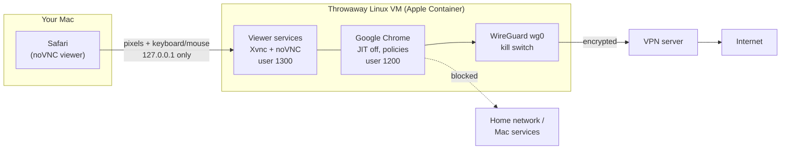

# secure-browser

**A disposable, VPN-locked browser for exploring untrusted websites on a Mac.**

Google Chrome runs inside its own throwaway Linux virtual machine (Apple Container). It's shown to you as a pixel stream in Safari, so a hostile page, such as a watering-hole attack, lands in a VM that's deleted when you close it. Your Mac never parses the page.

[](LICENSE)


> [!WARNING]
> **Use at your own risk.** Provided "as is", with no warranty and no liability of any kind, including for security, privacy, anonymity, computer safety, data loss or intellectual property. It reduces risk; it does not guarantee protection. See [LICENSE](LICENSE).
>
> **Please don't just trust this.** Don't take the claims here on faith. Read the code (it's one script), and run your own security scans and audits before relying on it, as you would with any security tool. If you fork or deploy it, turn on GitHub's code scanning, secret scanning and Dependabot for your copy. Found a vulnerability? Please report it privately through this repo's private vulnerability reporting (Security tab), not as a public issue or pull request. See [SECURITY.md](SECURITY.md).

---

## Why

Researching suspicious links, phishing kits or compromised sites from your everyday browser puts your Mac, accounts and identity one exploit away from the attacker. `secure-browser` puts several independent barriers in the way:

- **A separate VM per session.** It's created on launch, has a read-only system, and is deleted on exit.
- **Pixels only.** Safari shows a video of the browser. No clipboard sharing and no downloads to your Mac.
- **VPN with a kill switch.** With the bundled WireGuard setup, all traffic goes through your VPN. If the tunnel drops, there's no internet at all. Your home network and your Mac's own services are unreachable from the VM.
- **Hardened browser.** Official Google Chrome with same-day security fixes, the JavaScript JIT turned off, and enterprise policies that disable sync, sign-in, password saving, autofill, sensors, USB/Bluetooth and more.
- **Updates itself.** It rebuilds when Google or Debian ship fixes, and won't launch on an Apple Container version with known security issues; it offers to update instead.

Nothing to install but Apple's own Apple Container. **No Homebrew, no Docker, no extra viewer app.**

## Quick start

**Requirements:** a Mac with Apple silicon, macOS 26 or newer. Optional: a WireGuard config from any VPN provider (Proton VPN's free plan works).

```zsh
# 1. Get the script (read it first: it's one file)
curl -fsSL https://raw.githubusercontent.com/yshk-mxim/secure-browser/main/secure-browser -o ~/secure-browser
chmod 700 ~/secure-browser

# 2. (Recommended) Add your VPN: copy the WireGuard config text from your provider, then
~/secure-browser --import-vpn

# 3. Launch
~/secure-browser
```

The first run:

- installs or updates **Apple Container** from Apple's signed package, if needed (asks once, then asks for your admin password);
- **may override Homebrew for security.** If your `container` command comes from Homebrew, the launcher offers to uninstall that copy (`brew uninstall container`) and replace it with Apple's signed, notarized package, so security fixes actually apply. It asks first, keeps your images and volumes, and won't launch if you decline. It never installs Homebrew, and only uses it if it's already there (for `RESEARCH_MODE=0`);
- builds the browser VM image, which takes a few minutes;
- opens Safari with the browser inside.

When macOS asks to allow **"container-runtime-linux" to find devices on local networks**, choose **Allow**. That's Apple Container relaying the viewer from `127.0.0.1` into the VM. Your network stays blocked from inside the VM either way.

Then check everything once:

```zsh
~/secure-browser --test
```

## Extra isolation: run it from a separate Mac account

For an additional barrier, install and run `secure-browser` in a **dedicated macOS user account**, separate from the one you use day to day (create one in System Settings > Users & Groups, and switch to it with Fast User Switching). Then the account, the Apple Container VM and the browser inside it are three nested layers. Even if a hostile page escaped the browser and the VM, it would land in an account with none of your files, keychain, browser profiles or logins, and macOS file permissions keep it away from your main account.

- Do the install steps above while logged in as the dedicated account. Its images, volumes, VPN config and session state live in that account's home folder.
- Apple Container's installer is system-wide and asks for an admin password. If the dedicated account isn't an admin, install or update Apple Container once from an admin account; the launcher will then find it.
- Viewing needs a desktop session: be logged in on screen as that account (Fast User Switching or Screen Sharing). If you start it over SSH, or the launcher can't open Safari, it prints a ready-to-use login link and the password instead of stopping. Paste the link into Safari on that account's desktop, or run `~/secure-browser --open` from a Terminal there.
- The viewer listens on `127.0.0.1` of the Mac, so other accounts on the same Mac can reach the port, but they still need the per-session password.
- This is an extra layer, not a guarantee. Local privilege-escalation bugs in macOS exist, so keep macOS updated. Not yet tested on real Macs; see the limits below.

## Daily use

| Command | What it does |
|---|---|
| `~/secure-browser` | Check for updates, start a session, open the viewer. If a session is already running, reopens its viewer; if that session is out of date, offers to restart it. |
| `~/secure-browser --open` | Reopen the viewer for the running session, already logged in |
| `~/secure-browser --stop` | End the session (the VM is deleted) |
| `~/secure-browser --test` | Automated checks: tunnel, kill switch, exit IP, policy, isolation |
| `~/secure-browser --update` | Run every update check now and rebuild |
| `~/secure-browser --import-vpn` | Save a WireGuard config from the clipboard (private file, clipboard cleared) |
| `~/secure-browser --check` | Show what's installed; changes nothing |
| `~/secure-browser --uninstall` | Remove what it created, at a level you choose (see [Uninstall](#uninstall)) |

Inside the browser, use **Ctrl** shortcuts (Ctrl-T, Ctrl-L, Ctrl-W). Closing the last browser window ends the session.

## How it works



- **Kill switch by routing.** Before the browser starts, every route in the VM is replaced with a single route to the VPN server, and everything else is sent into the tunnel. The only exception: TCP replies from the viewer's own port back to the Mac. That port is held by a separate user, so the browser can't use it to reach your Mac. The browser user can't change routes.
- **Viewer password.** A fresh random password each session, passed to Safari in the URL fragment, which isn't sent to the server.
- **Defense in depth.** To reach your Mac, an attacker needs a browser exploit, then a privilege escalation inside the VM, then an exploit of Safari or of Apple's hypervisor.

## Settings

Edit the top of `~/secure-browser`. The main options:

| Setting | Default | |
|---|---|---|
| `RESEARCH_MODE` | `1` | `1` = the hardened mode described here. `0` = convenience mode: a native window via [Cocoa-Way](https://github.com/J-x-Z/cocoa-way), with optional clipboard, downloads and audio. |
| `VIEWER` | `safari` | or `screensharing` (macOS Screen Sharing; turn off its shared clipboard each session) |
| `BROWSER` | `chrome` | Google's official Chrome, or `chromium` (Debian's build) |
| `VPN` | `1` | WireGuard with kill switch, or `0` for a direct connection |
| `UPDATE_CHECK_HOURS` | `6` | How often to check for browser and Apple Container fixes |

The [full guide](docs/GUIDE.md) covers every option, the VPN setup walkthrough, convenience mode and troubleshooting.

## Uninstall

```zsh
~/secure-browser --uninstall
```

Pick how much to remove. Each level includes the ones before it, and nothing is deleted until you confirm the exact list:

| Level | Removes |
|---|---|
| 1. Session only | Stops the browser and deletes its VM and session state. Keeps the image, so the next launch is fast. |
| 2. + Browser image | Also deletes the built image and build folder, and stops the image builder. The next launch rebuilds. |
| 3. + Data | Also deletes the persistent profile volume, the Cocoa-Way app-list entry and the whole `~/.secure-browser-wayland` folder. |
| 4. + Everything | Also deletes your saved WireGuard config (`~/.config/secure-browser/wireguard.conf`) and the script itself. |

It never removes Apple Container, Homebrew packages, the shared Debian base image or your `~/Downloads/secure-browser` folder; it lists them at the end with the commands to remove them yourself. If you ran it from a separate Mac account, run `--uninstall` as that account. When you're done with the VPN account, also revoke the WireGuard config in your provider's dashboard.

## Where everything comes from

| Component | Source |
|---|---|
| Apple Container | Apple's signed and notarized `.pkg`, checksum-verified against the GitHub release |
| Google Chrome | Google's signed apt repository; the signing key is checked against Google's published fingerprint |
| VM base and tools | Debian's official image and signed repositories |
| Viewer | Safari or Screen Sharing (built into macOS) |
| VPN | Your provider's WireGuard config |

## Limits: read before relying on it

- **The viewer is still an attack surface.** Safari processes the VM's video stream and the viewer page. Keep macOS updated.
- **VM escapes are rare but real.** That's why Apple Container security updates block launching.
- **Not anonymity.** A VPN hides your IP from sites, not from the VPN provider. A Linux Chrome fingerprint is uncommon. Never sign in to your real accounts in the research browser. For anonymity, use Tor Browser.
- **For the most hostile targets** (APT infrastructure, links aimed at you personally), use a disposable cloud VM or spare hardware.
- **Early project.** Shell syntax, the kill-switch and viewer routing (in Linux network namespaces), and the update and advisory logic (with mocks) have been tested; broad testing on real Macs hasn't happened yet. Run `--test` on your machine and report what you find.

## Contributing

Issues and pull requests are welcome, especially reports from different Mac models and macOS versions, Apple Container versions and VPN providers. When reporting a problem, include the output of `~/secure-browser --test`, with IP addresses removed. For security vulnerabilities, don't use public issues or pull requests: report them privately as described in [SECURITY.md](SECURITY.md).

## License

[MIT](LICENSE) © 2026 Yakov Shkolnikov. Free to use, change and share with attribution. **No warranty and no liability of any kind.** Chrome, Apple Container, Debian packages, noVNC, TigerVNC, WireGuard, Cocoa-Way and VPN services are third-party software under their own licenses and terms.
